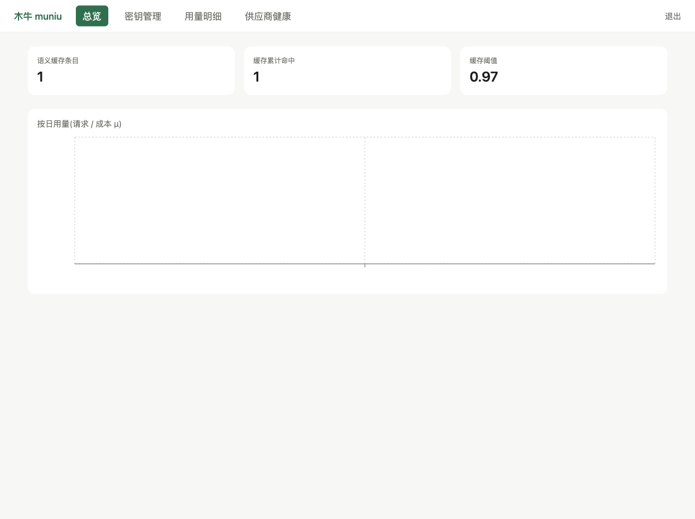
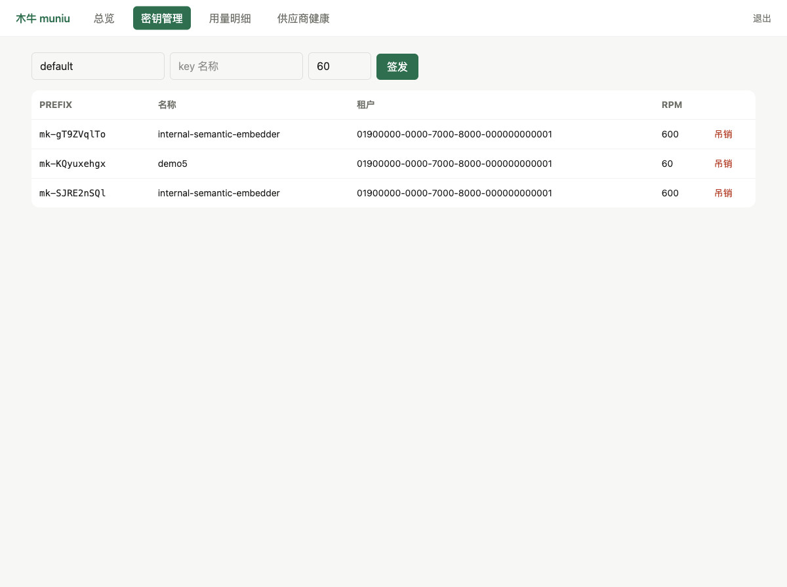
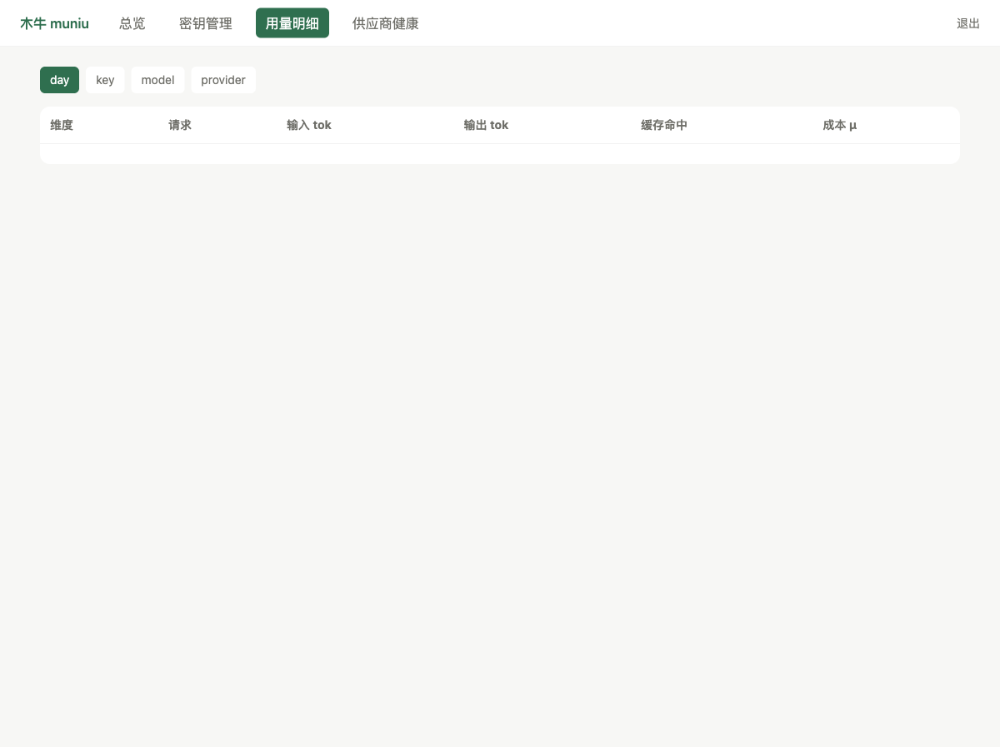
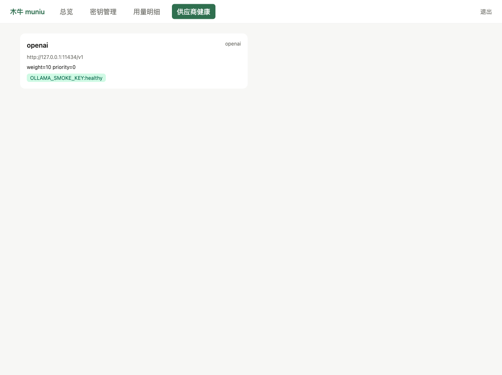

# 木牛 Muniu

[](https://github.com/qiyangfan/muniu/actions/workflows/ci.yml)

> **The model supply line for AI applications.**
> 木牛流马,蜀道粮车 —— 给 AI 应用运模型的网关。

**状态:v0.3.0 全功能落地,正向 v1.0.0 收口**——当前处于生产承载观察期(14 天零人工干预 + 对账 + 压测三闸门),判据见 [docs/v1-release-checklist.md](docs/v1-release-checklist.md)。

## 它是什么

muniu 是一个**单二进制、OpenAI 兼容入站**的 LLM 网关,用 Go 写成。它站在你的 AI 应用与各家模型供应商之间,把「换模型、管密钥、控成本、扛故障」这些脏活收进一条粮道:

```
 你的应用(kongming / 任意 OpenAI SDK)
        │  Authorization: Bearer mk-xxxx   (muniu 签发的 key)
        ▼
┌─────────────────────────────────────────────┐
│                  muniu 网关                  │
│  鉴权 → 租户/配额 → 限流 → 路由 → 流式代理     │
│         │            │           │          │
│    key 池调度   failover 语义   usage 计量计费 │
└───────┬─────────────┬─────────────┬──────────┘
        ▼             ▼             ▼
   DeepSeek       任意 OpenAI     Anthropic
   Moonshot       兼容端点        (协议桥接)
   GLM / Qwen / Doubao
```

一句话:**接入一次,后面随便换粮仓。**

## 功能全景

以下能力全部实现并测试覆盖(契约见 [docs/design/](docs/design/),验收轨迹见 [openspec/](openspec/changes/archive/)):

| 域 | 能力 |
|---|---|
| 接入 | OpenAI 兼容入站(chat/completions + embeddings + models 模型发现 + responses 无状态翻译 v1,ADR-0012);上游适配矩阵:DeepSeek / Moonshot / GLM(方言适配)、Qwen / Doubao(基座直用)、任意 OpenAI 兼容端点(如 ollama)、Anthropic(协议桥接) |
| 鉴权与租户 | `mk-` 平台 key 签发(SHA-256 落库 + LRU 缓存;key 级 RPM/TPM/日配额与过期时刻,运行态 PATCH 调整)、多租户隔离、日配额(事后记账模型) |
| 流量治理 | RPM 令牌桶 + TPM 滑动窗口;key 池平滑加权轮询 + EMA 健康度 + 三态状态机(健康/冷却/禁用);failover 首 token 边界语义;请求参数治理(模型能力目录,换道重治理,Raw 字节层改写零丢失) |
| 计量计费 | 流式 usage 归一 + tiktoken 离线估算兜底;分时段倍率;动态改价零重启;异步批量落库 + 缓冲续传 |
| 语义缓存 | HNSW 向量索引、相似度 0.97、「宁缺勿错」准入策略、租户级开关、TTL 24h |
| 运维观测 | 内嵌 React 控制台(单二进制自带)、管理 API、Prometheus `/metrics`(零依赖文本协议直写:请求/token 流向/缓存判定/流式首字节延迟/上游错误分类)、结构化访问日志 |

## 为什么再造一个网关

这个赛道不缺玩家(one-api / new-api / LiteLLM / Bifrost 各有山头),muniu 不做 provider 军备竞赛——适配矩阵的维护洪水是公司化团队的游戏,单人项目跟不起。muniu 押的是四件现有网关没做扎实(或对中文生态是二等公民)的事:

1. **国产模型协议兼容性测试集(conformance)**:DeepSeek / Moonshot / GLM / Qwen / Doubao 的流式形态、usage 字段、reasoning token、错误码差异,以可回放的 fixture 测试集形式固化——测试集本身是独立资产,网关是它的第一个消费者。
2. **Agent 流式语义**:failover 的「首 token 边界」语义(首 token 前透明换道、首 token 后如实断言)、流式下的 usage 归一与估算、客户端断连向上下游的取消传导——为 Agent 工作流而设计,不是聊天补全的赠品。
3. **零依赖单二进制形态**:`CGO_ENABLED=0` 纯静态编译、嵌入式 SQLite(WAL)、直接依赖仅 7 个(含 redis 后端与 miniredis 测试件,ADR-0008 修订),`muniu` 一条命令起服,零 compose、零外部数据库。这不是洁癖,是把故障面降到最小——运行时依赖越少,能坏的东西越少。
4. **精确计量计费闭环**:分时段倍率、动态改价零重启、事后记账的取舍(宁可记账精确、偶发小额超限)——面向「要把 token 当账算」的运营者,不是成本预算的粗粒度近似。

## 快速开始

```bash
# 1. 配置:复制示例,按需改 provider 与价目(key 走环境变量,绝不写进 YAML)
cp muniu.example.yaml muniu.yaml
export DEEPSEEK_API_KEY_1=sk-...

# 2. 签一把访问 key(明文仅此一次展示)
make build
./bin/muniu keys create --name my-app        # → mk-xxxx

# 3. 起服(默认 :8787)并调用
./bin/muniu
curl http://127.0.0.1:8787/v1/chat/completions \
  -H "Authorization: Bearer mk-xxxx" \
  -d '{"model":"deepseek-chat","stream":true,"messages":[{"role":"user","content":"你好"}]}'
```

本地无供应商 key 时,任何 OpenAI 兼容端点(如 [ollama](https://ollama.com))都可直接当上游:
`adapter: openai` + `base_url: "http://127.0.0.1:11434/v1"`。

## 双形态(ADR-0005)

muniu 是 LLM 网关**数据面**,两种部署形态,同一二进制:

- **standalone(缺省,一等公民)**:单二进制 + 内嵌 SQLite,上面的快速开始即此形态;租户/key/价目为运营态(管理面在线改),拓扑走 YAML。
- **cluster(无状态副本)**:多副本 + LB,SQLite 降级本地缓冲;租户/key/价目/拓扑经控制面拉取(`metering.pricing_url` / `auth.revocations_url` / `control_plane.topology_url`,ETag 条件请求、损坏拒绝应用、失联保持降级),计量经 `metering.sink: ingest` 推送控制面(失败落本地缓冲,恢复按序续传,ADR-0007);限流为实例级自治 + 控制面全局预算(ADR-0008)。每实例本地状态盘点与集群口径见 `docs/design/cluster-semantics.md`。

本位币与 credit(计量计费):`cost_credits`/`daily_quota_credits` 均为 credit 整数,1 credit = 本位币(`metering.settlement`,CNY|USD)的十亿分之一;异币种报价经 `metering.fx_usd_cny_milli` 加载期一次换算。

## 控制台与语义缓存

设置 `MUNIU_ADMIN_TOKEN` 后启动,浏览器打开 `http://127.0.0.1:8787/console/` 即进入内置控制台(随二进制分发,无需额外部署):

| 总览:用量/成本/缓存命中 | 密钥管理 | 用量明细 | 供应商健康 |
|---|---|---|---|
|  |  |  |  |

**语义缓存**(`semantic:` 配置,租户级开关默认关):同义问题直接返回缓存的参考答案,省 token 降延迟。
采用「宁缺勿错」保守策略:temperature ≤ 0.3、`finish_reason=stop`、无工具调用、输入 ≤8K tokens 才准入;
相似度阈值 0.97、TTL 24h、LRU 容量上限;**缓存的是相似问题的一次参考答案**,不做主动失效。
命中行照记 `usage_logs`(`provider=semantic-cache`,cost 0),命中率进控制台首屏。

## 性能

压测口径先行:以下为**同机假上游、SSE 流式**下网关数据面的纯转发开销——真实 LLM 场景的延迟与吞吐瓶颈在上游模型(秒级)与带宽,这组数字回答的是「网关自身吃掉多少」,而不是「端到端快多少」。硬件、方法、p50/p99 全量数据见 [docs/benchmarks/2026-09-10.md](docs/benchmarks/2026-09-10.md)。

| 并发 | 产品 | 成功率 | 首字节 p50 | 吞吐 |
|---|---|---|---|---|
| 100 | muniu | 100% | 1.15ms | 1,444 rps |
| 100 | one-api v0.6.10 | 100% | 8.98ms | 255 rps |
| 1000 | muniu | 100% | 17.28ms | 38,498 rps |
| 1000 | one-api v0.6.10 | 100% | 1,748ms | 456 rps |
| 5000 | muniu | 100% | 81.96ms | 23,477 rps |
| 5000 | one-api v0.6.10 | 99.8% | 9,760ms | 454 rps |

单流转发增量开销 6μs/chunk(`BenchmarkSSEForward`,1000 事件)。

## 工程纪律

网关的可靠性不靠口号,靠可回放的证据:

- **10 篇 ADR**([docs/adr/](docs/adr/)):每个不可逆选型(纯标准库、事后记账、Sink 抽象、参数治理……)都有为什么,以及被拒绝的替代方案。
- **conformance fixture 回放测试**([conformance/](conformance/)):七家上游(OpenAI 兼容基座 / DeepSeek / Moonshot / GLM / Qwen / Doubao / Anthropic)的真实响应形态固化为 fixture,适配器正确性可离线回归。
- **chaos 演练**(`internal/proxy/chaos_test.go`):failover 判定表 26 格覆盖 + 上游故障注入(半帧、断连、超时)。
- **全仓 `-race`**:`make check` 即全量门禁,数据竞争零容忍。
- **openspec 变更管理**:每个行为变更走提案 → 实现 → 归档,specs 与实现的一致性可审计。
- **12 步请求生命周期契约**([docs/design/architecture.md](docs/design/architecture.md)):middleware 链序即契约,stdlib-first,无框架。

## 核心语义

**failover 的「首 token 边界」**([docs/design/proxy-and-streaming.md](docs/design/proxy-and-streaming.md)):
请求对客户端产出第一个内容帧之前,任何失败都可透明换道重放(换 provider、换 key);
之后客户端已收到部分生成内容,重放必然造成内容重复——唯一正确行为是**如实断言**:
发流内错误帧 + `data: [DONE]` 干净收尾,并按已转发部分估算计量。

**key 池三态**:健康 → 冷却(429 按 Retry-After 指数退避上限 30min;5xx 连续 3 次冷却 30s)→ 到期自动恢复;
401/403 直接禁用(人工介入级)。健康度 = 最近 20 次结果 EMA 成功率,有效权重 = weight × max(0.1, 成功率),防饿死。

**配额一致性 FAQ**:为什么偶发小额超限?配额与 TPM 均为**事后记账**模型——请求进行时无法预知最终
token 数,muniu 的取舍是「宁可记账精确、偶发小额超限」,不做预留式伪精确(预留复杂度与 token
上限的不可知性不成比例)。

## 双形态部署

- **standalone(缺省,一等公民)**:`muniu` 一条命令起服——单二进制 + 内嵌 SQLite,`muniu.yaml` 静态拓扑/价目,零外部依赖。
- **cluster(无状态副本)**:多副本 + LB + 控制面(价目/拓扑/吊销下发,计量 ingest 回推)。参考部署样例与控制面对接契约见 [deploy/cluster/](deploy/cluster/README.md);每实例分片语义与集群口径见 [docs/design/cluster-semantics.md](docs/design/cluster-semantics.md)。

配置开关:`control_plane.topology_url` / `pricing_url` / `auth.revocations_url` / `metering.sink: ingest`——全部缺省关闭,standalone 行为零回归。

## 文档地图

| 文档 | 内容 |
|---|---|
| [docs/ROADMAP.md](docs/ROADMAP.md) | 六阶段路线、验收闸门、backlog |
| [docs/design/](docs/design/) | 架构、流式与 failover 语义、适配器矩阵、流量治理、计量、缓存、存储与配置 |
| [docs/adr/](docs/adr/) | 关键选型决策(为什么) |
| [docs/benchmarks/](docs/benchmarks/) | 压测报告(口径、方法、全量数据) |
| [docs/articles/](docs/articles/) | 设计复盘系列(可对外发的工程文章) |
| [docs/conventions.md](docs/conventions.md) | 工程约定(代码/测试/错误/日志/迁移) |
| [AGENTS.md](AGENTS.md) | AI 执行者工作契约(铁律在此) |

## 设计复盘系列

1. [首 token 边界:LLM 网关 failover 的正确语义](docs/articles/01-first-token-boundary.md)
2. [流式 usage 计量:各家差异与估算兜底](docs/articles/02-streaming-usage-metering.md)
3. [conformance:把「兼容」变成测试集](docs/articles/03-conformance-as-asset.md)
4. [单二进制取舍:纯 Go SQLite 与零外联](docs/articles/04-single-binary-tradeoffs.md)

## License

[Apache-2.0](LICENSE)。

## 致谢

设计受 [one-api](https://github.com/songquanpeng/one-api)、[LiteLLM](https://github.com/BerriAI/litellm)、[Bifrost](https://github.com/maximhq/bifrost) 等先行的启发;参考其逻辑,未复制其代码。
